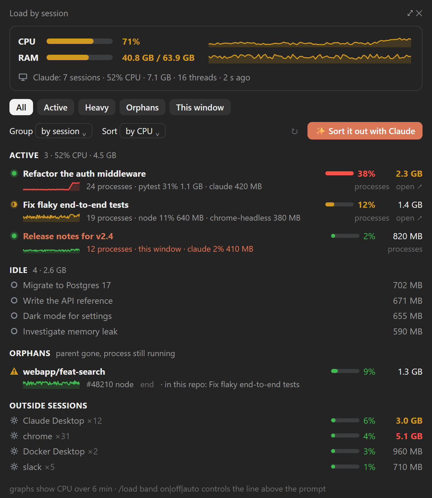
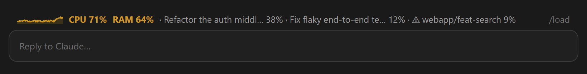
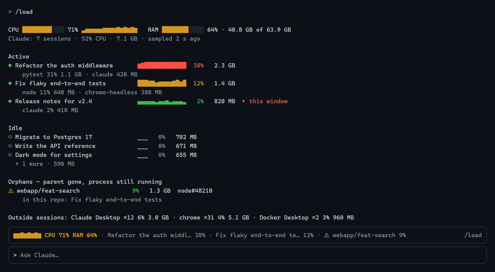

<div align="center">

**English** · [Русский](README.ru.md) · [Deutsch](README.de.md) · [Español](README.es.md) · [Français](README.fr.md) · [Português](README.pt.md) · [中文](README.zh.md) · [日本語](README.ja.md)

# claude-load

**See which Claude Code session eats your CPU and memory — and clean it up in one click.**

[](LICENSE)








<sub>Rendered from demo data in the mod's own design.</sub>

</div>

## Install

One command; pick your shell. It adds this repository as a plugin marketplace and installs
the mod for your user, so it loads in every new session, in the terminal and in the Claude
desktop app alike.

**macOS · Linux · Git Bash on Windows**

```bash
claude plugin marketplace add Gerrux/claude-load && claude plugin install claude-load@claude-load --config language=auto
```

**Windows — PowerShell** (5.1 and 7)

```powershell
claude plugin marketplace add Gerrux/claude-load; if ($?) { claude plugin install claude-load@claude-load --config language=auto }
```

**Windows — Command Prompt** (`cmd`)

```bat
claude plugin marketplace add Gerrux/claude-load && claude plugin install claude-load@claude-load --config language=auto
```

**Claude desktop app only** (no `claude` command in your terminal): click **+** next to
the prompt box → **Plugins** → **Add marketplace** → `Gerrux/claude-load` → **Add plugin**
→ **claude-load**.

**Inside a Claude Code terminal session:**

```text
/plugin marketplace add Gerrux/claude-load
/plugin install claude-load@claude-load
```

Then, in a session that was already open, run `/reload-plugins` and `/load`.

| | |
| --- | --- |
| **Requires** | Claude Code with mods support, 2.1.287 or later (`claude --version`); Windows 10/11, macOS or Linux |
| **Language** | `--config language=auto` follows Claude Code's language, then the system locale. Pin one with `en`, `ru`, `de`, `es`, `fr`, `pt`, `zh` or `ja`, or change it later in `/config` |
| **Update** | `claude plugin marketplace update claude-load` then `claude plugin update claude-load@claude-load`, then `/reload-plugins` |
| **Remove** | `claude plugin uninstall claude-load@claude-load` (and `claude plugin marketplace remove claude-load`) |

## Why

Run a few Claude Code sessions in parallel, each with subagents, MCP servers, dev servers
and test runners, and the machine crawls while Task Manager shows a wall of `node` and
`claude`. claude-load splits the load **by session**:

| | |
| --- | --- |
| 📊 **Per session** | CPU, memory, process count, the heaviest processes inside, a 6-minute CPU graph |
| ⚠️ **Orphans** | dev processes whose parent died (a vite server, a language server, a Python run left behind), placed in their repository or worktree by working directory, ended with one click after a confirmation |
| 🧩 **Everything else** | other processes folded by name (`chrome ×31`), so you see whether the problem is Claude at all |
| 🔎 **Filters & groups** | all · active · heavy · orphans · this window; by session, by repository (worktrees folded in), by process name; sort by CPU or memory |
| ✨ **Sort it out with Claude** | one button: the bundled `sessions-triage` skill classifies idle sessions and orphans, asks once, archives or ends only what you approve |
| 🚦 **Load line** | above the prompt under high load (CPU ≥ 50% or memory ≥ 85%), with the top consumers |
| 🌍 **8 languages** | English, Русский, Deutsch, Español, Français, Português, 中文, 日本語 |

## Use

| Command | What it does |
| --- | --- |
| `/load` | Opens the pane and prints a compact report in the transcript |
| `/load all` | The same, with every idle session listed |
| `/load band on` · `off` · `auto` | The load line above the prompt: always, never, or only under high load (default) |

In the pane:

- **processes** expands a session into its processes by name and its heavy PIDs.
- **end** on a process or an orphan ends it with its child processes after
  **Yes, end it**. The PID is checked again against a fresh sample under the same name
  first. Sessions' own `claude` processes and PIDs not in the current sample cannot be
  ended from here.
- **open ↗** switches to that session in the Claude desktop app.
- **✨ Sort it out with Claude** asks Claude in the current session to triage the load.
  Archiving sessions needs the desktop app's session tools; in a terminal Claude tells you
  what to close instead.

Filter, grouping and sorting are remembered across sessions.

**Language:** the plugin's `language` option (`/config`) takes `auto`, `en`, `ru`, `de`,
`es`, `fr`, `pt`, `zh` or `ja`. `auto` follows Claude Code's `language` setting, then the
system locale, then English.

## How it works

One sampler per machine writes `~/.claude/state/load/snapshot.json`; each session's mod
only reads it every 5 seconds, so the cost does not grow with the number of sessions.

- **Windows:** a hidden PowerShell process (`sampler/load-sampler.ps1`) started by the
  mod. It reads `Get-Process` every 4 seconds and the parent tree from CIM only when new
  processes appear, and exits 3 minutes after the last session closes. Measured on a
  12-thread machine with 15 sessions: about 0.35% CPU and 130 MB of memory.
- **macOS and Linux:** one session's mod holds a lease and samples with `ps`; another
  session takes over within 15 seconds if it goes away.

A session is a PID from `~/.claude/sessions/<pid>.json`, and its load is its whole process
tree. An orphan is a process tree whose parent died (on macOS and Linux: reparented to
`init`, `systemd` or `launchd`) and that contains a dev tool. Its working directory comes
from the process itself (Windows reads it from the process's memory, Linux from
`/proc/<pid>/cwd`, macOS from `lsof`).

**Privacy:** everything stays on your machine. No network calls, no telemetry.

## Troubleshooting

- **"The sampler does not start"** (Windows): PowerShell scripts are blocked by policy
  (`AllSigned` or Constrained Language Mode). The sampler needs to run
  `sampler/load-sampler.ps1` from the plugin folder.
- **Nothing shows on macOS/Linux:** check that `ps` is on `PATH`; `lsof` (macOS) is
  needed only for orphans.

## Status

Developed and used daily on Windows 11 with the Claude desktop app. The macOS and Linux
sampler is covered by unit tests on recorded `ps`, `vm_stat`, `/proc/meminfo` and `lsof`
output but has not yet run on a real Mac or Linux box. Reports and fixes are welcome.

## Develop

```bash
claude plugin validate .
claude plugin test .
claude --plugin-dir .
```

Screenshots are rendered from `docs/mock/index.html`; see [docs/mock/README.md](docs/mock/README.md).

## License

[MIT](LICENSE)
