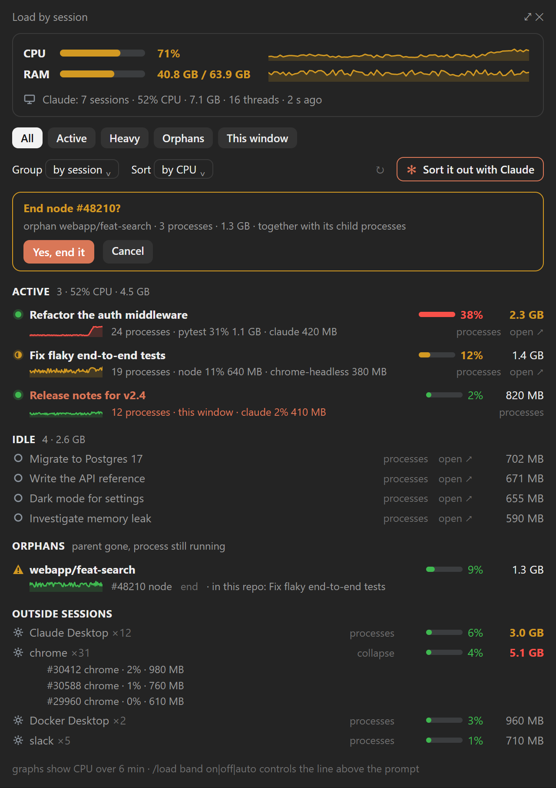
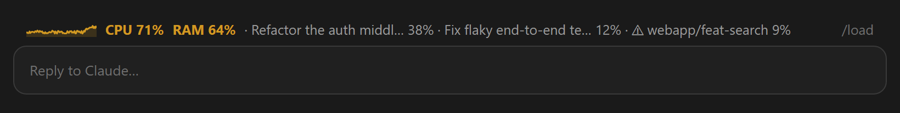
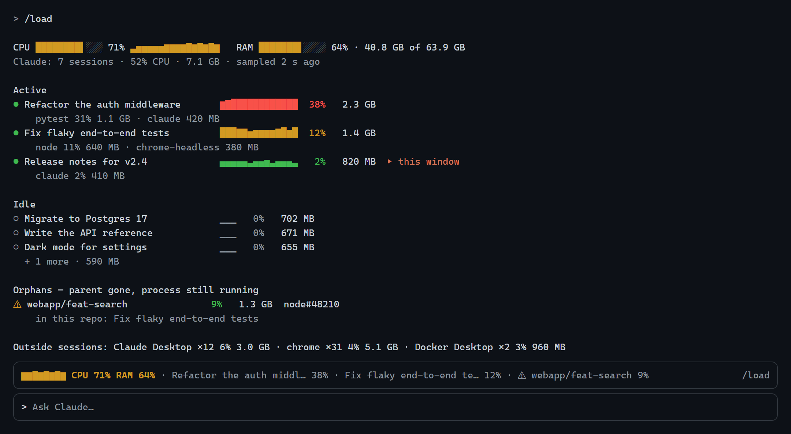

<div align="center">

[English](README.md) · [Русский](README.ru.md) · [Deutsch](README.de.md) · [Español](README.es.md) · [Français](README.fr.md) · **Português** · [中文](README.zh.md) · [日本語](README.ja.md)

# claude-load

**Veja qual sessão do Claude Code está consumindo sua CPU e sua memória — e limpe tudo com um clique.**

[](LICENSE)








<sub>Geradas a partir de dados de demonstração, no design próprio do mod.</sub>

</div>

## Instalação

Um único comando; escolha o seu shell. Ele adiciona este repositório como marketplace de
plugins e instala o mod para o seu usuário, de modo que ele é carregado em toda nova
sessão, tanto no terminal quanto no aplicativo desktop do Claude.

**macOS · Linux · Git Bash no Windows**

```bash
claude plugin marketplace add Gerrux/claude-load && claude plugin install claude-load@claude-load --config language=auto
```

**Windows — PowerShell** (5.1 e 7)

```powershell
claude plugin marketplace add Gerrux/claude-load; if ($?) { claude plugin install claude-load@claude-load --config language=auto }
```

**Windows — Prompt de Comando** (`cmd`)

```bat
claude plugin marketplace add Gerrux/claude-load && claude plugin install claude-load@claude-load --config language=auto
```

**Somente o aplicativo desktop do Claude** (sem o comando `claude` no terminal): clique em
**+** ao lado da caixa do prompt → **Plugins** → **Add marketplace** →
`Gerrux/claude-load` → **Add plugin** → **claude-load**.

**Dentro de uma sessão de terminal do Claude Code:**

```text
/plugin marketplace add Gerrux/claude-load
/plugin install claude-load@claude-load
```

Depois, em uma sessão que já estava aberta, execute `/reload-plugins` e `/load`.

| | |
| --- | --- |
| **Requisitos** | Claude Code com suporte a mods, versão 2.1.287 ou superior (`claude --version`); Windows 10/11, macOS ou Linux |
| **Idioma** | `--config language=auto` segue o idioma do Claude Code e, depois, a localidade do sistema. Fixe um com `en`, `ru`, `de`, `es`, `fr`, `pt`, `zh` ou `ja`, ou mude depois em `/config` |
| **Atualizar** | `claude plugin marketplace update claude-load`, depois `claude plugin update claude-load@claude-load` e então `/reload-plugins` |
| **Remover** | `claude plugin uninstall claude-load@claude-load` (e `claude plugin marketplace remove claude-load`) |

## Por quê

Rode várias sessões do Claude Code em paralelo, cada uma com subagentes, servidores MCP,
servidores de desenvolvimento e executores de testes, e a máquina engasga enquanto o
Gerenciador de Tarefas mostra um paredão de `node` e `claude`. O claude-load divide a carga
**por sessão**:

| | |
| --- | --- |
| 📊 **Por sessão** | CPU, memória, número de processos, os processos mais pesados dentro dela, um gráfico de CPU de 6 minutos |
| ⚠️ **Órfãos** | processos de desenvolvimento cujo processo pai morreu (um servidor vite, um servidor de linguagem, uma execução de Python deixada para trás), situados no seu repositório ou worktree pelo diretório de trabalho e encerrados com um clique após uma confirmação |
| 🧩 **Todo o resto** | outros processos agrupados por nome (`chrome ×31`), para você ver se o problema é mesmo o Claude |
| 🔎 **Filtros e grupos** | Todos · Ativos · Pesados · Órfãos · Esta janela; por sessão, por repositório (com os worktrees incorporados), por processo; ordenação por CPU ou memória |
| ✻ **Resolver com o Claude** | um botão: a skill `sessions-triage` incluída classifica as sessões ociosas e os órfãos, pergunta uma única vez e arquiva ou encerra somente o que você aprovar |
| ⏳ **Fila de execuções** | o `runq` faz as execuções pesadas de todas as sessões se revezarem na máquina conforme a memória, as tags exclusivas e o disco; um guardião opcional as envia para lá |
| 🚦 **Linha de carga** | acima do prompt sob carga alta (CPU ≥ 50% ou memória ≥ 85%), com os maiores consumidores |
| 🌍 **8 idiomas** | English, Русский, Deutsch, Español, Français, Português, 中文, 日本語 |

## Uso

| Comando | O que faz |
| --- | --- |
| `/load` | Abre o painel e imprime um relatório compacto na transcrição |
| `/load all` | O mesmo, com todas as sessões ociosas listadas |
| `/load band on` · `off` · `auto` | A linha de carga acima do prompt: sempre, nunca ou só sob carga alta (padrão) |

No painel:

- **processos** expande uma sessão em seus processos por nome e seus PIDs pesados.
- **encerrar** em um processo ou em um órfão o encerra junto com seus processos filhos
  depois de **Sim, encerrar**. Antes, o PID é verificado novamente em uma amostra recente
  com o mesmo nome. Os processos `claude` das próprias sessões e os PIDs que não estão na
  amostra atual não podem ser encerrados por aqui.
- **abrir ↗** muda para aquela sessão no aplicativo desktop do Claude.
- **✻ Resolver com o Claude** pede ao Claude, na sessão atual, que analise a carga.
  Arquivar sessões exige as ferramentas de sessão do aplicativo desktop; em um terminal, o
  Claude diz o que você deve fechar.

O filtro, o agrupamento e a ordenação são lembrados entre as sessões.

**Idioma:** a opção `language` do plugin (`/config`) aceita `auto`, `en`, `ru`, `de`,
`es`, `fr`, `pt`, `zh` ou `ja`. `auto` segue a configuração `language` do Claude Code,
depois a localidade do sistema e, por fim, o inglês.

## Fila de execuções (runq)

Várias sessões em uma mesma máquina iniciam, cada uma, uma execução que consome muita
memória (um conjunto de testes, uma simulação, uma compilação grande), e a máquina fica sem
memória, ou duas execuções que compartilham caminhos temporários atrapalham uma à outra. O
`runq` faz com que se revezem sozinhas: cada comando pesado espera em uma única fila para a
máquina inteira até haver espaço para ele e então roda normalmente.

```bash
python "$HOME/.claude/state/queue/runq.py" --mem 20 --tag helios --label "scan 1 ha" -- ./target/release/treegrow-cli scan --plot 1ha
```

A mesma linha funciona no Git Bash e no PowerShell (`$HOME` é expandido nos dois; em outros
lugares use `python3`). Exige Python 3.8 ou posterior. O mod copia o `runq.py` para
`~/.claude/state/queue/` a cada início de sessão, de modo que o caminho continua o mesmo
entre atualizações do plugin.

Um job espera, por ordem de chegada, até que tudo isto seja verdade:

- **memória:** o commit livre (o que o Windows ainda pode prometer: RAM mais arquivo de
  paginação) cobre o `--mem` do job mais uma margem, 12 GB por padrão. Os jobs em execução
  contam com o que declararam e ainda não ocuparam, então dois jobs admitidos com um segundo
  de diferença não veem ambos a mesma memória livre. Um job menor pode passar na frente de
  um maior que espera memória; depois que o maior esperou 5 minutos, nada que precise de
  memória passa na frente dele.
- **tags exclusivas:** nenhum job em execução, nem nenhum job enfileirado antes, tem a mesma
  tag exclusiva. `cargo-test` é exclusiva por padrão: um `cargo test` por máquina.
- **disco:** cada unidade de `--disk D:=<GB>` tem esse espaço livre, menos o que os jobs em
  execução declararam para ela e ainda não gravaram.

Então o runq executa o comando como seu próprio filho, com o stdin, o stdout e o stderr do
terminal, e termina com o código de saída do comando. As linhas do próprio runq vão para o
stderr e começam com `runq:`: uma linha de progresso a cada 30 s enquanto espera (por que
espera) e, no fim, a saída, o tempo de execução e o pico de memória.

| Opção | |
| --- | --- |
| `--mem <GB>` | o pico de memória esperado da execução (obrigatório; `0` para uma execução que só precisa de uma tag) |
| `--tag <name>` | repetível; exclusiva se estiver em `exclusiveTags` |
| `--disk D:=<GB>` | repetível; espaço livre que uma unidade deve ter (um caminho no macOS/Linux) |
| `--label <text>` | como o painel e o log chamam o job (padrão: o comando) |
| `--max-mem <GB>` | encerra a árvore de processos do próprio comando se ele passar desse valor |
| `--max-wait <min>` | desiste depois de esperar tanto (saída 75) |

| Saída | |
| --- | --- |
| a do comando | ele rodou |
| 2 | erro de uso |
| 3 | `--mem` mais a margem excede o limite de commit da máquina: nunca poderia iniciar |
| 75 | o `--max-wait` esgotou |
| 126 | o comando não pôde ser iniciado (por exemplo, um `.exe` recém-compilado que o Microsoft Defender bloqueia: `Permission denied`); informado uma vez, nunca repetido |
| 127 | comando não encontrado |
| 130 | cancelado (Ctrl+C) durante a espera |
| 137 | encerrado pelo seu próprio `--max-mem` |

`runq.py status` mostra o que roda e o que espera (e por quê), o commit livre, a RAM e os
discos; `runq.py log --since 30m` (ou `-n 50`, um horário ISO, `--json`) mostra os eventos:
queued, started, finished, killed, failed, stale, cancelled, gave-up. O painel mostra o
mesmo em uma seção **Fila de execuções** enquanto algo roda ou espera, e por duas horas
depois.

**O que o runq toca.** Ele lê a memória de outros processos apenas pelos totais da máquina.
Os únicos processos que ele encerra são a árvore do seu próprio comando, e só com
`--max-mem`. No Windows, o comando roda em um Job Object: sua árvore são exatamente os
membros do job, cada um é verificado como pertencente ao job antes de ser encerrado, e um
runq que é ele mesmo morto leva seu comando junto em vez de deixá-lo rodando sem
contabilização. Onde não é possível criar um job (e no macOS/Linux), a árvore é percorrida
pelo PID do pai, e o horário de início de cada processo é verificado antes de ele ser
encerrado. Um job cujo runq e comando sumiram (uma falha, uma reinicialização) é descartado
por PID e horário de início; um comando que continua rodando depois que seu runq morreu
mantém sua vaga e suas tags. As decisões são tomadas sob um bloqueio de arquivo do SO, que o
SO libera quando seu detentor morre.

**Configurações:** `~/.claude/state/queue/config.json`, todas opcionais:

```json
{
  "guardGB": 12,
  "exclusiveTags": ["cargo-test"],
  "fairAfterMin": 5,
  "guard": {
    "roots": ["C:/Users/me/garage/treegrow", "D:/work/treegrow-*"],
    "rules": [{ "name": "cargo test", "pattern": "^cargo(\\s+\\+\\S+)?\\s+(test|nextest)\\b", "tag": "cargo-test", "memGB": 8 }]
  }
}
```

### O guardião: comandos pesados somente pelo runq

Em um projeto que o ativa, um comando de Bash ou PowerShell que inicia uma execução pesada
fora do runq é negado, e o agente recebe no lugar a linha exata do runq que deve executar
(com o seu `cd …&&` e o seu `| tail` mantidos). O mod nunca reescreve nem executa um comando
por conta própria. Ative-o para um projeto no `.claude/settings.json` dele (compartilhado,
então todos os seus worktrees o têm) ou em `.claude/settings.local.json`:

```json
{ "env": { "CLAUDE_LOAD_RUNQ_GUARD": "1" } }
```

ou para pastas, worktrees incluídos, com `guard.roots` em `config.json` (`*` representa uma
parte do caminho); `"0"` nas configurações de um projeto o desativa ali. São pesados por
padrão: `cargo test` / `cargo nextest`, `treegrow*` `grow|scan|stand|forest` (um executável
ou `cargo run … -- <verb>`) e `helios*`; `guard.rules` substitui a lista.

## Como funciona

Um amostrador por máquina grava `~/.claude/state/load/snapshot.json`; o mod de cada sessão
apenas o lê a cada 5 segundos, então o custo não cresce com o número de sessões.

- **Windows:** um processo oculto do PowerShell (`sampler/load-sampler.ps1`) iniciado pelo
  mod. Ele lê `Get-Process` a cada 4 segundos e a árvore de processos pai via CIM somente
  quando surgem novos processos, e encerra 3 minutos depois que a última sessão é fechada.
  Medido em uma máquina de 12 threads com 15 sessões: cerca de 0,35% de CPU e 130 MB de
  memória.
- **macOS e Linux:** o mod de uma sessão mantém um lease e amostra com `ps`; outra sessão
  assume em até 15 segundos se essa desaparecer.

Uma sessão é um PID de `~/.claude/sessions/<pid>.json`, e sua carga é toda a sua árvore de
processos. Um órfão é uma árvore de processos cujo pai morreu (no macOS e no Linux:
reatribuído a `init`, `systemd` ou `launchd`) e que contém uma ferramenta de
desenvolvimento. Seu diretório de trabalho vem do próprio processo (o Windows o lê da
memória do processo, o Linux de `/proc/<pid>/cwd`, o macOS via `lsof`).

**Privacidade:** tudo fica na sua máquina. Sem chamadas de rede, sem telemetria.

## Solução de problemas

- **"O amostrador não inicia"** (Windows): os scripts do PowerShell estão bloqueados por
  política (`AllSigned` ou Constrained Language Mode). O amostrador precisa executar
  `sampler/load-sampler.ps1` a partir da pasta do plugin.
- **Nada aparece no macOS/Linux:** verifique se `ps` está no `PATH`; o `lsof` (macOS) só é
  necessário para os órfãos.

## Status

Desenvolvido e usado diariamente no Windows 11 com o aplicativo desktop do Claude. O
amostrador para macOS e Linux é coberto por testes unitários sobre saídas gravadas de `ps`,
`vm_stat`, `/proc/meminfo` e `lsof`, mas ainda não rodou em um Mac ou em uma máquina Linux
de verdade. Relatos e correções são bem-vindos.

## Desenvolvimento

```bash
claude plugin validate .
claude plugin test .
python -m unittest discover -s runq -v
claude --plugin-dir .
```

As capturas de tela são geradas a partir de `docs/mock/index.html`; veja [docs/mock/README.md](docs/mock/README.md).

## Licença

[MIT](LICENSE)
